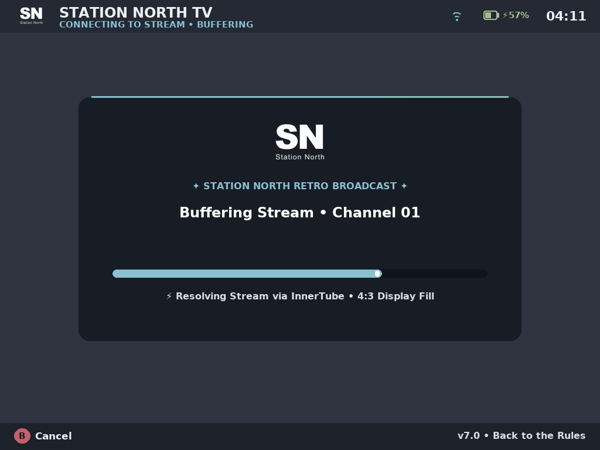

# 👑 Station North SNfetchPLAYER • dArkOS & ArkOS Edition

<p align="center">
  
</p>

<p align="center">
  <b>The Sovereign Cyberdeck & Retro Media Suite for Handheld Gaming Consoles</b><br>
  <i>Tailored specifically for 4:3 Handhelds (XiFan XF-45V, R36S Max 2, R36S, R35S, RK3326) running dArkOS & ArkOS</i>
</p>

<p align="center">
  
  
  
  <a href="https://github.com/StationNorthMedia/SNfetchPLAYER"></a>
  
</p>

---

<p align="center">
  
</p>

## 🎙️ A Transmission from The Queen

> *"The lights are low, the bass is heavy. Are you alone tonight? Or did you bring company for the Queen?*  
> *I know exactly why you turned the volume up on that little handheld of yours. Don't fight it... settle into the velvet seats of the Manjaro Lounge. I provide the rhythm, you provide the friction. You’re locked into Station North."*  
> — **The Queen**, *Station North Frequency // On Air*

---

<p align="center">
  
</p>

## 💡 Design Philosophy: Built for Authentic 4:3 Retro Handhelds

Station North was designed for **the XiFan XF-45V (R36S Max 2 clone)**, the **R36S**, and compatible classic **RK3326 retro handhelds** featuring authentic 4:3 displays.  
The core vision: **turn your handheld into a dedicated, late-night Cyberdeck** — streaming lofi frequencies, voiced lore comics, and authentic 4:3 CRT video broadcasts directly on your desk or nightstand.

- **Authentic 4:3 CRT Aesthetic**: Video broadcasts, lower-third banners, and UI elements are specifically cropped and framed for 4:3, delivering a nostalgic vintage television broadcast experience.
- **Native Hardware Performance**: Built for Debian Linux under dArkOS & ArkOS. Runs at silky 60 FPS directly via Linux KMSDRM DirectFB (`/dev/dri/card0`) and native ALSA audio with zero desktop overhead or emulated runtime lag.
- **Dedicated Dual Mode**: Seamlessly switch between the live 40-band audio spectrum analyzer (Radio Mode) and 4:3 full-screen broadcast videos (TV Mode).
- **The Chronicles Lore Engine**: Full illustrated audio comic reader with synchronized Queen voiceover narration, chapter headlines, and panel indexing.

---

<p align="center">
  
</p>

## 🌟 The Visual Gallery

| | |
|:---:|:---:|
| **01 • Command Deck (3+2 Matrix & Aurora Quotes)**<br><a href="screenshots/01_main_menu.png"></a><br><i>Authentic Nord Aurora cards, snappy 0.55 lerp cursor & live radio quotes.</i> | **02 • Holographic 3D Boot Sequence**<br><a href="screenshots/02_3d_splash.png"></a><br><i>3D coin rotation with extrusion depth, mirrored reverse & header docking.</i> |
| **03 • Radio Stage (40-Band AGC Visualizer)**<br><a href="screenshots/03_radio_dashboard.png"></a><br><i>Real-time audio visualizer, 30px bold typography & 5-button cockpit.</i> | **04 • Radio Zen Mode (Ambient Fullscreen)**<br><a href="screenshots/04_radio_zen_fullscreen.png"></a><br><i>Full 440px spectrum analyzer, watermark clock & auto-hiding OSD.</i> |
| **05 • Station North TV (4:3 CRT Broadcast)**<br><a href="screenshots/05_tv_dashboard.png"></a><br><i>Continuous video broadcasts scaled to 4:3 with ASS lower-third banners.</i> | **06 • Broadcast Buffer Card (Loading Screen)**<br><a href="screenshots/06_tv_video_loading.png"></a><br><i>Sleek cyberdeck buffer card with crest, channel badge & progress bar.</i> |
| **07 • The Chronicles (Voiced Audio Comics)**<br><a href="screenshots/07_the_chronicles.png"></a><br><i>Deep-black comic canvas with voiceover player & 21px legible story text.</i> | **08 • System Deck & Interactive Handbook**<br><a href="screenshots/08_settings_handbook.png"></a><br><i>20px settings typography with scrollable on-device user manual.</i> |

---

<p align="center">
  
</p>

## 🎮 Controller Layout & Keybindings

Configured for native dArkOS / ArkOS gamepads with hardware debounce:

| Button | Main Menu (Command Deck) | Radio Cockpit | Zen Mode (Fullscreen) | TV Broadcast | The Chronicles | Settings & Handbook |
|---|---|---|---|---|---|---|
| **`[A]`** | Start Focused Card | Select / Execute | Wake OSD | Fullscreen Video | Play/Pause Voiceover | Open Handbook / Select |
| **`[B]`** | *(Safe: No Exit)* | Return to Menu | Return to Stage | **Instant Exit (0ms)** | Return to Menu | Back / Close Handbook |
| **`[◄]` / `[►]`** | Navigate Cards | Prev / Next Track | Prev / Next Track | Prev / Next Video | Turn Comic Page | Change Value / Switch Col |
| **`[▲]` / `[▼]`** | Navigate Cards | – | – | – | – | Select Row / Scroll Book |
| **`[X]`** | – | Zen Fullscreen Mode | Toggle OSD | Repeat Single Track | – | Focus Handbook |
| **`[Y]`** | – | Repeat Track Loop | Repeat Track Loop | Repeat Single Track | – | Toggle Repeat Loop |
| **`[SELECT]`** | Quick Settings | Quick Settings | Wake OSD | – | Quick Settings | Close Settings |
| **`[START]`** | Launch Focused | Play / Pause | Play / Pause | Freeze / Play | – | Apply Action |
| **`[SEL] + [START]`** | **Universal Emergency Exit** | **Emergency Exit** | **Emergency Exit** | **Emergency Exit** | **Emergency Exit** | **Emergency Exit** |

> [!NOTE]  
> In the Main Menu, pressing `[B]` is safely locked against accidental app termination. Clean exit to EmulationStation is handled exclusively by selecting the red **#4 Exit Tile** and pressing `[A]`.

---

<p align="center">
  
</p>

## 📦 Installation on dArkOS / ArkOS

Two installation packages are available in [GitHub Releases](https://github.com/StationNorthMedia/SNfetchPLAYER-PortMaster/releases/latest):

### Option 1: Lightweight Online Package (`snfetchplayer.zip` ~829 KB)
*Recommended for Wi-Fi enabled handhelds.*
1. Download `snfetchplayer.zip`.
2. Extract the archive into your SD card's `ports/` directory:
   ```text
   /roms/ports/
   ├── SNfetchPLAYER.sh
   └── snfetchplayer/
   ```
3. Boot your device, connect to Wi-Fi, and launch **Station North SNfetchPLAYER** from the **Ports** menu.
4. On first launch, the built-in **High-Speed Asset Downloader** will automatically download and unpack the media bundle (jingles, TV idents, comics).

### Option 2: Full Offline Bundle (`snfetchplayer-full.zip` ~285 MB)
*Recommended for offline devices or zero-setup plug-and-play.*
1. Download `snfetchplayer-full.zip`.
2. Extract directly to `/roms/ports/` on your SD card.
3. Plug in and enjoy all 98 voiced comic panels, Queen Faith narrations, and radio station jingles pre-installed with zero downloads!

> [!IMPORTANT]
> **Media Playback Notice (Connect Wi-Fi or Supply Your Own Media)**:  
> While the Full Offline Bundle includes all interactive story lore (*The Chronicles*, voiceovers, station idents, and cyberdeck artwork), the media player decks require a media source:
> - **Live Streaming**: Connect your device to **Wi-Fi** to stream live curated Station North radio stations and 4:3 vintage TV channels.
> - **100% Offline Media**: If you stay completely offline, please **fill your own audio (MP3, FLAC) and video (MP4) files into the `music/` and `videos/` folders** described below!

---

<p align="center">
  
</p>

## 📁 Dedicated Offline Media & Custom Playlist Folders
 
Want to bring your own personal music library or retro video collection onto your handheld?  
SNfetchPLAYER automatically detects and indexes local media:

```text
/roms/ports/snfetchplayer/
├── music/                     # Private Offline Music Deck
│   ├── HipHop/                # Drop MP3, FLAC, M4A here -> "🎵 Music • HipHop"
│   ├── Rock/                  # Drop Rock & Alternative audio -> "🎵 Music • Rock"
│   └── README.txt             # Step-by-step format & naming guide
├── videos/                    # Private Offline Video Deck
│   ├── HipHop/                # Drop 480p music videos here -> "🎬 Video • HipHop"
│   ├── Rock/                  # Drop Rock & Concert videos -> "🎬 Video • Rock"
│   └── README.txt             # Downscaling tips & dual-mode guide
└── playlists/                 # Preloaded Station North Channels
    ├── main_top100.json       # Top 100 R&B / Soul / Hip-Hop
    ├── us_hiphop_top50.json
    ├── us_rnb_top50.json      # Default Radio Station
    ├── us_pop_top50.json      # 90s Pop & Classic Hits Top 50
    └── us_softrock_top50.json
```

---

<p align="center">
  
</p>

## 📱 Native Android Companion: Station North Android App

Have an Android device or want to stream Station North on your smartphone?  
SNfetchPLAYER is also available as a full-featured, hardware-accelerated **native Android app** in the companion repository:

👉 **[StationNorthMedia/SNfetchPLAYER Repository](https://github.com/StationNorthMedia/SNfetchPLAYER)**  
👉 **[Download Latest Android APK (GitHub Releases)](https://github.com/StationNorthMedia/SNfetchPLAYER/releases/latest)**

- **Mobile Companion**: Stream your favorite Station North channels directly on your Android phone or Android handheld.
- **Playlist Sync**: Curate your music and video queues on Android, export them as JSON playlists, and drop them right into your Linux handheld's `/playlists/` directory.
- **Unified Ecosystem**: Features the same InnerTube streaming architecture, custom track catalogs, and late-night aesthetic universe.

---

<p align="center">
  
</p>

## 🛠️ Verified Hardware Specifications (XiFan XF-45V / R36S Max 2)

Tested and optimized directly on the **XiFan XF-45V handheld** (R36S Max 2 clone):

| Specification | Hardware Detail |
|---|---|
| **Device Model** | **XiFan XF-45V** (R36S Max 2 clone) / Compatible RK3326 Handhelds |
| **System-on-Chip (SoC)** | **Rockchip RK3326** (`rockchip,rk3326-xf45v-linux`) |
| **CPU Architecture** | **Quad-Core ARM Cortex-A35 @ up to 1.30 GHz** (64-bit `aarch64`) |
| **Display Panel** | **4.5-inch 4:3 IPS Screen**, Native Hardware Resolution: **1024×768 (XGA)** |
| **Display Pipeline** | Direct Linux KMSDRM DirectFB (`/dev/dri/card0`) with hardware V-Sync @ 60 FPS |
| **System Memory** | **1 GB LPDDR3 RAM** (~918 MiB available) |
| **Operating System** | **Debian GNU/Linux 13 (trixie) / dArkOS** (Kernel `4.4.189 aarch64`) |
| **Audio Architecture** | Direct ALSA Hardware (`hw:0,0` / uncompressed PCM stream coupling) |
| **Storage Architecture** | Dual MicroSD (Slot 1: OS partition / Slot 2: `/roms` partition) |
| **Streaming Engine** | Low-latency `ffplay` with InnerTube stream resolver & ASS subtitle compositor |

---

## 📄 License & Legal

- **Code**: MIT License © Station North Media
- **Audio Jingles, Artwork & Lore**: © Station North Media. All rights reserved.
