# 👑 Station North SNfetchPLAYER • Universal PortMaster Edition

<p align="center">
  
</p>

<p align="center">
  <b>The Sovereign Cyberdeck & Retro Media Suite for Handheld Linux Gaming Consoles</b><br>
  <i>Officially packaged for PortMaster: Compatible with muOS, ROCKNIX, ArkOS, AmberELEC, Knulli / Batocera & classic 4:3 Handhelds (XiFan XF-45V, R36S, Anbernic RG35XX/RG40XX, TrimUI, Powkiddy, RK3326/RK3566)</i>
</p>

<p align="center">
  
  
  
  
  <a href="https://github.com/StationNorthMedia/SNfetchPLAYER"></a>
  
</p>

---

<p align="center">
  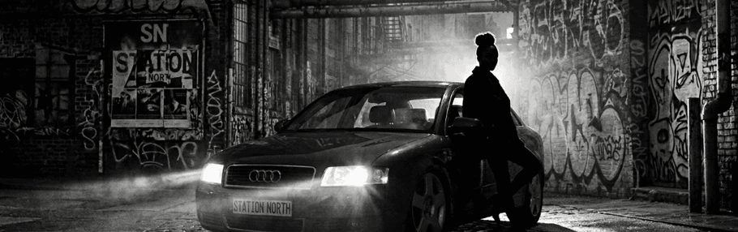
</p>

## 🎙️ A Transmission from The Queen

> *"Dusty records, cold street corners, and second chances. That's what this frequency is built on.*  
> *The lights are low, the bass is heavy. Are you alone tonight? Or did you bring company for the Queen?*  
> *I know exactly why you turned the volume up on that little handheld of yours. Don't fight it... settle into the velvet seats of the Manjaro Lounge. I provide the rhythm, you provide the friction. You’re locked into Station North."*  
> — **The Queen**, *Station North Frequency // On Air*

---

<p align="center">
  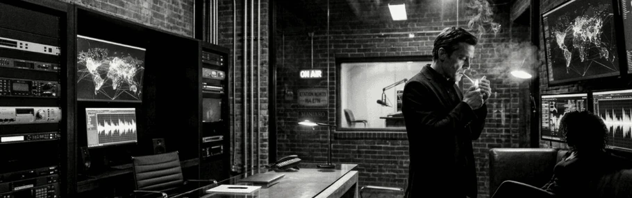
</p>

## 💡 Design Philosophy: Universal PortMaster & PC Architecture

Station North was designed to turn your retro gaming handheld or Linux PC into a **dedicated late-night Cyberdeck** — streaming curated lofi frequencies, voiced lore comics, and authentic 4:3 CRT video broadcasts directly on your desk or nightstand.

- **Universal PortMaster Compatibility**: Built to run self-contained on minimal buildroot distributions (**muOS, ROCKNIX, AmberELEC, Knulli**) as well as Debian-based systems (**ArkOS, dArkOS**).
- **Official PortMaster Runtime (`python_3.11`)**: Uses PortMaster's shared `python_3.11.squashfs` runtime via Harbourmaster, ensuring zero dependency bloat and no need for OS-level `apt` or package managers.
- **Dedicated PC Suite Mode (`run_on_pc.sh`)**: Features an intelligent environment doctor for **Ubuntu, Debian, Pop!_OS, Arch, and Fedora**, auto-checking system prerequisites (Python 3, libmpv, ffmpeg, curl) and launching an OpenGL-accelerated companion window.
- **TV Studio Deck (2-Card Stage)**: Authentic retro broadcast monitor featuring translucent frosted glass overlays, live audio visualizer, studio telemetry (`MATRIX STEREO • 48 kHz`), and dynamic channel selector.
- **Direct Hardware DRM Video Pipeline**: Video broadcasts render zero-latency direct to KMS/DRM framebuffer on RK3326 Mali-G31 handhelds, with authentic 4:3 Pan & Scan framing, top-right lower thirds, and doubled watermark branding.
- **Radio Stage & Zen Fullscreen**: Features a 40-band organic AGC audio spectrum analyzer, smoothly spinning 33 RPM vinyl turntable, and active playlist badge pill.
- **The Chronicles Lore Engine**: Full illustrated audio comic reader with synchronized Queen voiceover narration, chapter headlines, and panel indexing.
- **Offline Ready**: Includes built-in royalty-free demo tracks and retro looping video reels, allowing standalone offline playback with zero configuration.

---

<p align="center">
  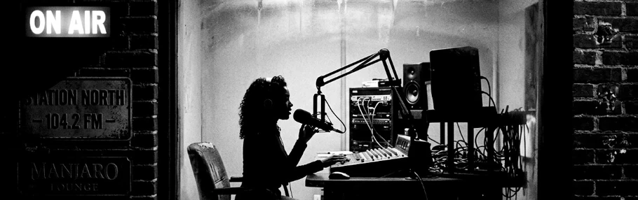
</p>

## 🌟 The Visual Gallery

| | |
|:---:|:---:|
| **01 • Command Deck (3+2 Matrix & Aurora Quotes)**<br><a href="screenshots/01_main_menu.png">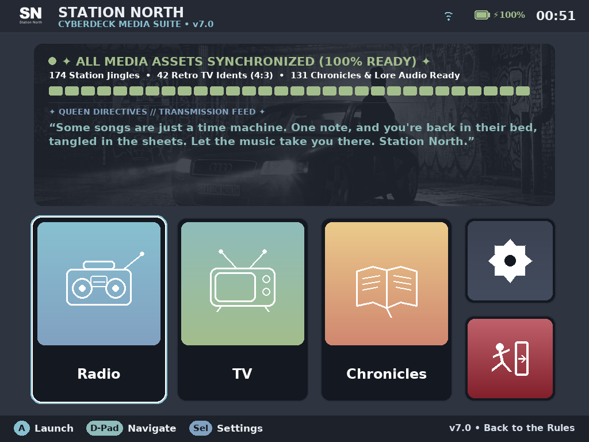</a><br><i>Authentic Nord Aurora cards, snappy 0.55 lerp cursor & dynamic asset badge.</i> | **02 • Holographic 3D Boot Sequence**<br><a href="screenshots/02_3d_splash.png">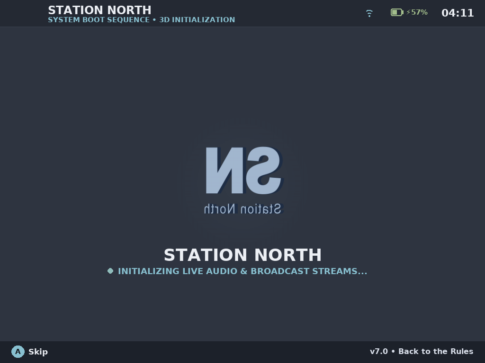</a><br><i>3D coin rotation with extrusion depth, mirrored reverse & header docking.</i> |
| **03 • Radio Stage (Vinyl & Spectrum Analyzer)**<br><a href="screenshots/03_radio_dashboard.png">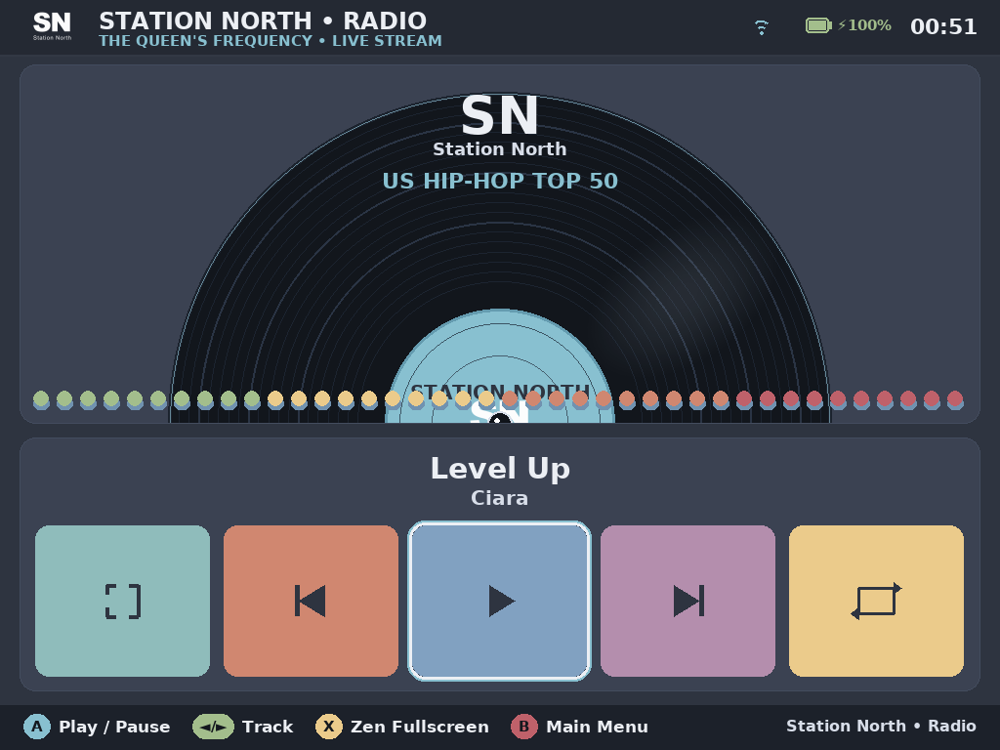</a><br><i>Real-time audio visualizer, dynamic active playlist branding & 5-button cockpit.</i> | **04 • Radio Zen Mode (Ambient Fullscreen)**<br><a href="screenshots/04_radio_zen_fullscreen.png">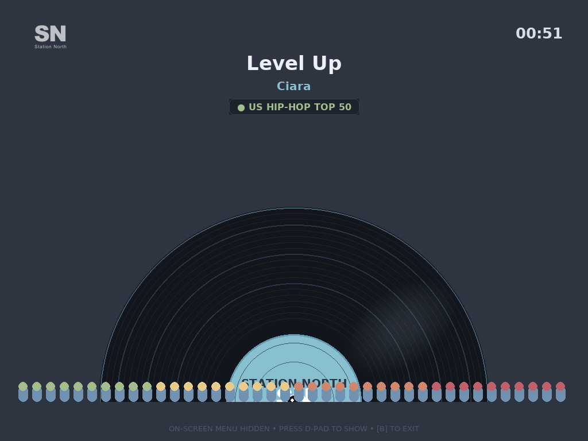</a><br><i>Full 440px spectrum analyzer, turntable, clock & glowing playlist badge.</i> |
| **05 • TV Studio Deck (Frosted CRT Monitor)**<br><a href="screenshots/05_tv_dashboard.png">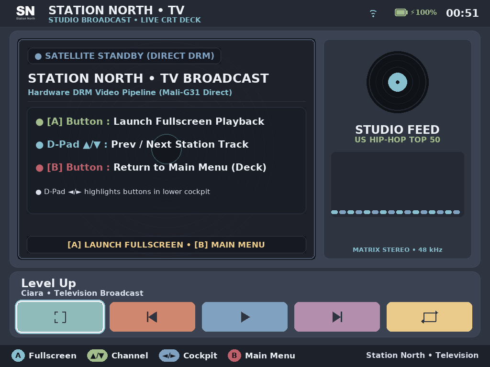</a><br><i>Frosted glass overlay, active TV playlist, telemetry tag & 5-button deck cockpit.</i> | **06 • TV Fullscreen (4:3 CRT Broadcast)**<br><a href="screenshots/06_tv_video_fullscreen.png">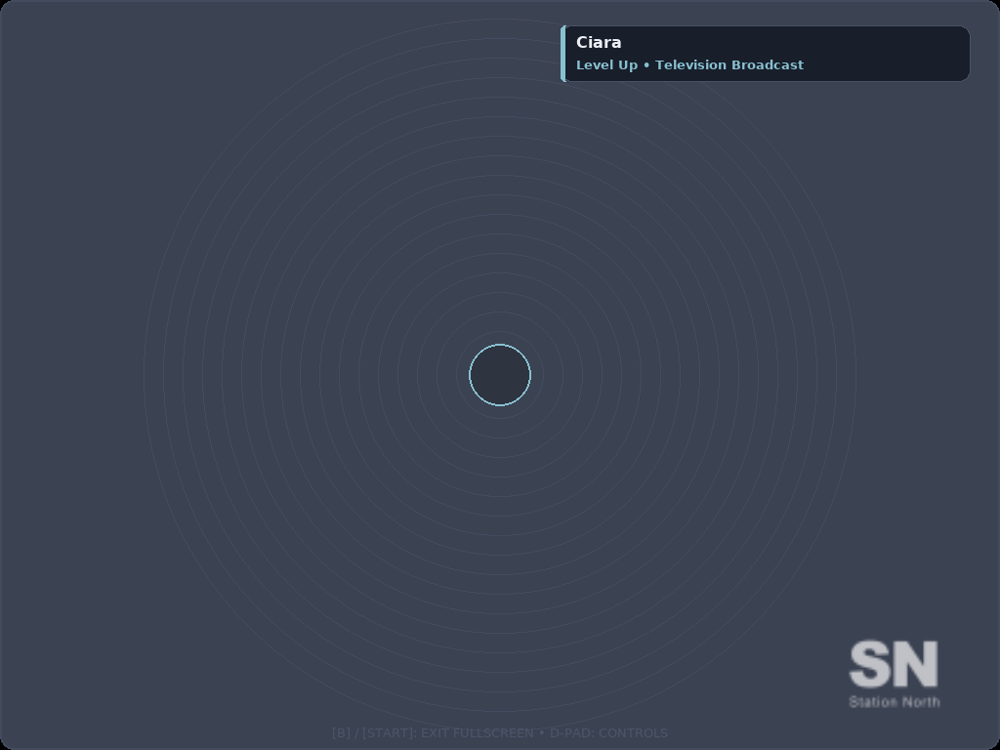</a><br><i>Top-Right MTV-style Lower Third, doubled watermark logo & zero-latency video.</i> |
| **07 • The Chronicles (Voiced Audio Comics)**<br><a href="screenshots/07_the_chronicles.png">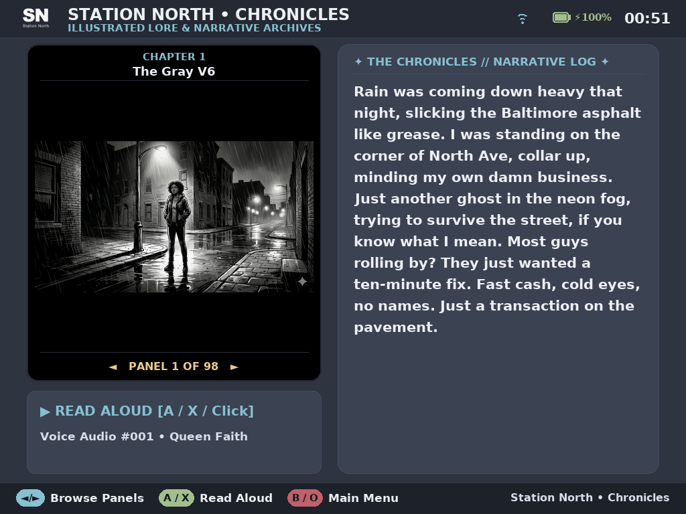</a><br><i>Deep-black comic canvas with voiceover player & 21px legible story text.</i> | **08 • System Deck & Interactive Handbook**<br><a href="screenshots/08_settings_handbook.png">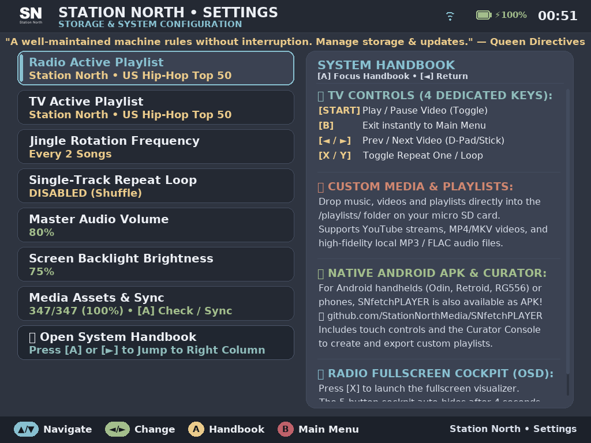</a><br><i>Channel playlist selector, volume mixer & scrollable on-device user manual.</i> |

---

<p align="center">
  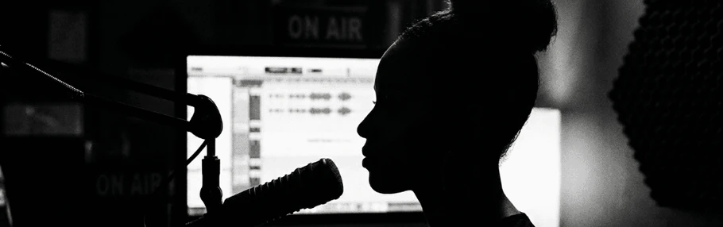
</p>

## 🎮 Controller Layout & Keybindings

Configured for native dArkOS / ArkOS gamepads with hardware debounce:

| Button | Main Menu (Command Deck) | Radio Cockpit | Zen Mode (Fullscreen) | TV Studio Deck | TV Fullscreen | The Chronicles | Settings |
|---|---|---|---|---|---|---|---|
| **`[A]`** | Start Focused Card | Select / Execute | Wake OSD | Launch Fullscreen | Wake OSD | Play/Pause Voice | Open Handbook / Select |
| **`[B]`** | *(Safe: No Exit)* | Return to Menu | Return to Stage | Return to Menu | **Exit Fullscreen** | Return to Menu | Back / Close Handbook |
| **`[◄]` / `[►]`** | Navigate Cards | Prev / Next Track | Prev / Next Track | Cockpit Buttons | Cockpit Buttons | Turn Comic Page | Change Value / Col |
| **`[▲]` / `[▼]`** | Navigate Cards | – | – | Prev / Next Station | – | – | Select Row / Scroll |
| **`[X]`** | – | Zen Fullscreen | Toggle OSD | Launch Fullscreen | Repeat Video | – | Focus Handbook |
| **`[Y]`** | – | Repeat Track Loop | Repeat Track Loop | Repeat Single Video | – | – | Toggle Repeat Loop |
| **`[SELECT]`** | Quick Settings | Quick Settings | Wake OSD | Quick Settings | – | Quick Settings | Close Settings |
| **`[START]`** | Launch Focused | Play / Pause | Play / Pause | Play / Pause | Freeze / Play | – | Apply Action |
| **`[SEL] + [START]`** | **Universal Exit** | **Universal Exit** | **Universal Exit** | **Universal Exit** | **Universal Exit** | **Universal Exit** | **Universal Exit** |

---

<p align="center">
  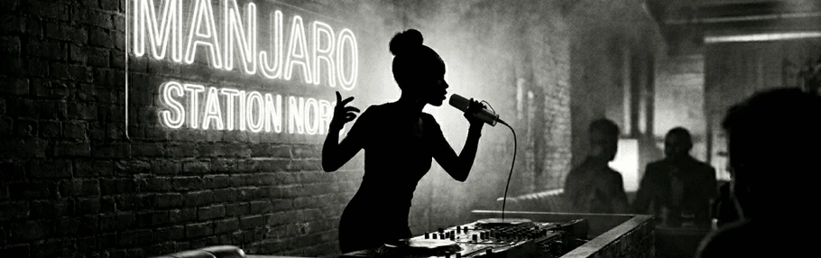
</p>

## 📦 Installation & Setup

### A. PortMaster Handheld Installation (muOS, ROCKNIX, ArkOS, AmberELEC, Knulli)

#### Method 1: PortMaster GUI (Recommended)
1. Open **PortMaster** on your handheld console.
2. Search for **Station North SNfetchPLAYER** in **All Ports**.
3. Click **Install**. PortMaster automatically configures the shared `python_3.11` runtime.

#### Method 2: Manual Installation via GitHub Releases
Two installation packages are available in [GitHub Releases](https://github.com/StationNorthMedia/SNfetchPLAYER-Universal/releases/latest):

* **Lightweight Store Package (`snfetchplayer.zip` ~380 KB)**:  
  Recommended for Wi-Fi enabled handhelds. Extract into `/roms/ports/` on your SD card. On first launch, the built-in High-Speed Asset Downloader automatically downloads and unpacks media assets.
* **Full Offline Bundle (`snfetchplayer-full.zip` ~285 MB)**:  
  Recommended for offline consoles. Extract into `/roms/ports/`. Includes all 174 station jingles, 42 retro TV idents, 131 voiced comic pages, and **offline royalty-free demo music and video reels** so you can play immediately with zero internet connection!

---

### B. Linux PC Installation (Ubuntu, Debian, Pop!_OS, Arch, Fedora)

Run Station North directly on your desktop or laptop with hardware OpenGL video acceleration:

1. Clone the repository:
   ```bash
   git clone https://github.com/StationNorthMedia/SNfetchPLAYER-Universal.git
   cd SNfetchPLAYER-Universal
   ```
2. Start the automated launcher and dependency doctor:
   ```bash
   ./run_on_pc.sh
   ```
3. The script will automatically verify system tools (`mpv`, `libmpv-dev`, `ffmpeg`, `curl`), set up a clean Python virtual environment, install required packages, and launch the player in windowed mode (1024×768).

---

<p align="center">
  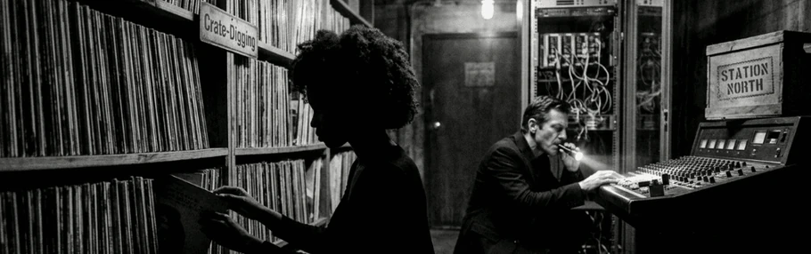
</p>

## 📻 Curated Channels, Playlists & Offline Media

### 🎶 Active Playlist Curation
The radio and television channels are actively curated and updated by Station North. Preloaded channels include:
* **Main Top 100**: The flagship late-night frequency (Soul, R&B, and Hip-Hop).
* **US Hip-Hop Top 50**: Golden age and modern street anthems.
* **US R&B Top 50**: Velvet vocals, slow jams, and deep 808s.
* **US 90s Pop Top 50**: Nostalgic chart-toppers and retro classics.
* **US Soft Rock Top 50**: Midnight drives and acoustic ballads.
* **Essential Selection**: The Queen's handpicked personal rotation.

> [!NOTE]  
> New playlists and genre rotations are actively published. You can switch between active channels on the fly in the **Settings Menu** or by pressing **D-Pad ▲/▼** in the TV Studio Deck.

### 📁 Adding Your Own Offline Music & Videos
Want to bring your personal offline library onto your device? Drop files directly into the dedicated folders:
```text
snfetchplayer/
├── music/                     # Private Offline Music Deck
│   ├── HipHop/                # Drop MP3, FLAC, M4A here -> "🎵 Music • HipHop"
│   ├── Rock/                  # Drop Rock & Alternative audio -> "🎵 Music • Rock"
│   └── README.txt             # Format & naming guide (Artist - Title.mp3)
├── videos/                    # Private Offline Video Deck
│   ├── HipHop/                # Drop MP4 video files here -> "🎬 Video • HipHop"
│   ├── Rock/                  # Drop concert & music videos -> "🎬 Video • Rock"
│   └── README.txt             # Downscaling tips & 4:3 framing guide
└── playlists/                 # Station North JSON channel feeds
```

---

<p align="center">
  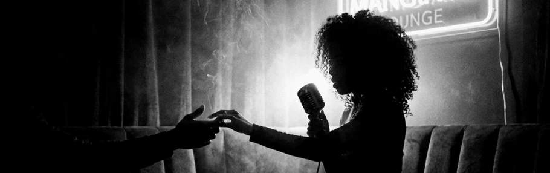
</p>

## 📱 Mobile Companion: Station North Android App

Have an Android smartphone or Android-based gaming handheld?  
SNfetchPLAYER is also available as a full-featured, hardware-accelerated **native Android app**:

👉 **[StationNorthMedia/SNfetchPLAYER Repository](https://github.com/StationNorthMedia/SNfetchPLAYER)**  
👉 **[Download Latest Android APK](https://github.com/StationNorthMedia/SNfetchPLAYER/releases/latest)**

- **Mobile Companion**: Stream your favorite Station North channels on the go.
- **Playlist Sync**: Create custom queues on your phone, export them, and drop them into your Linux handheld's `/playlists/` directory.
- **Unified Aesthetic**: Shares the identical frequency, lore universe, and Queen Faith narrative.

---

<p align="center">
  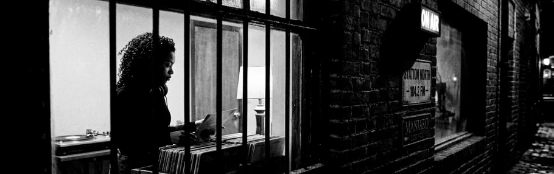
</p>

## 🛠️ Verified Hardware Specifications

Tested and optimized on **XiFan XF-45V** (R36S Max 2) and RK3326/RK3566 Linux handhelds:

| Specification | Hardware Detail |
|---|---|
| **Device Model** | **XiFan XF-45V** (R36S Max 2) / RK3326 & RK3566 Compatible Consoles |
| **SoC / CPU** | **Rockchip RK3326** Quad-Core ARM Cortex-A35 @ 1.30 GHz (64-bit `aarch64`) |
| **GPU Pipeline** | **ARM Mali-G31 MP2** Direct Linux KMS/DRM (`/dev/dri/card0`) @ 60 FPS |
| **Display Panel** | **4.5-inch 4:3 IPS Screen**, Native Hardware Resolution: **1024×768 (XGA)** |
| **Operating System** | **Debian GNU/Linux 13 / dArkOS** & PortMaster Runtimes (`python_3.11`) |
| **Audio Architecture** | Direct ALSA Hardware (`hw:0,0`) Uncompressed PCM Stream Coupling |

---

## 📄 License & Legal

- **Software Engine**: MIT License © Station North Media
- **Audio Jingles, Artwork & Lore**: © Station North Media. All rights reserved.
- **Demo Media**: Royalty-free Creative Commons audio (Kevin MacLeod) & open video timelapses.

